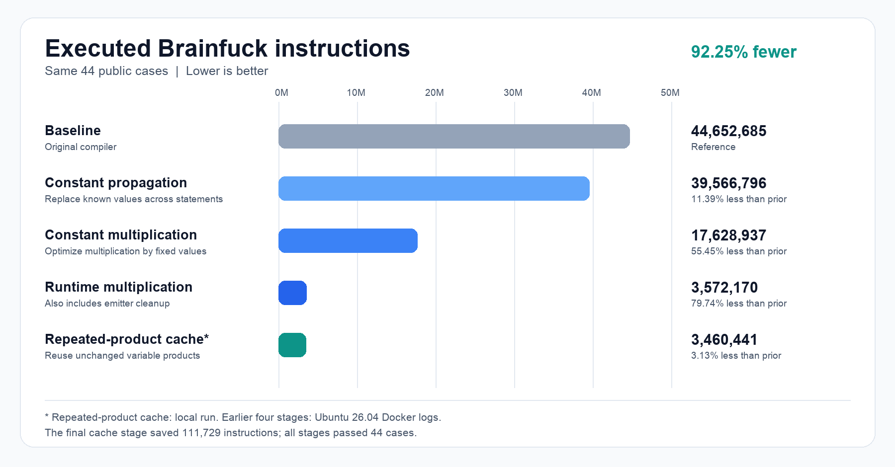

# HW3: Expr to Brainfuck 編譯器 - 115062536 謝文珈

Advanced C++: Large-Scale Projects and Object-Oriented Design Homework 3: Expression to Brainfuck Compiler

## 作業心得

這次作業讓我了解，將 Expr 轉成 Brainfuck 需要完整的編譯流程。我先規劃逐行移除註解、切出 token、建立敘述與表達式樹、檢查變數、最佳化表達式，最後配置 Brainfuck 記憶體格並輸出程式。

實作時，我特別注意運算子優先順序，以及指派敘述必須先算完右側，才能覆寫左側變數。例如 `a = a * (a + 1)` 必須保留原本的 `a`。暫存格重用前也必須確認其值已清零。此外，即使 `input()` 的結果未被使用，仍須保留讀取動作，避免改變後續輸入的順序。

最佳化方面，程式會進行常數折疊、跨敘述常數傳播及無效指派移除。產生 Brainfuck 時，我也減少不必要的暫存格清零與複製；常數乘法使用較省步數的運算方式，兩個執行期數值相乘則採用「乘數減半、被乘數加倍」的方法。目前另在本機測試重複乘法結果的快取，以減少相同運算的執行次數。

## 最佳化項目與效果

下圖比較同一組 44 個公開案例的總執行步數。`Executed instructions` 是 BrainfuckRunner 執行產出程式時的指令數，包含迴圈反覆執行的指令，不是 Expr 編譯器執行的 C++ 指令數。所有版本均通過這 44 個案例。



| 版本與主要變更 | 總執行步數 | 比前一版本減少 |
| --- | ---: | ---: |
| 原始版本：語法與語意檢查、常數折疊、無效指派移除 | 44,652,685 | — |
| 加入跨敘述常數傳播 | 39,566,796 | 5,085,889（11.39%） |
| 最佳化常數乘法產碼 | 17,628,937 | 21,937,859（55.45%） |
| 改進執行期乘法及暫存格產碼 | 3,572,170 | 14,056,767（79.74%） |
| 快取重複的變數乘積（本機測試） | 3,460,441 | 111,729（3.13%） |

- **常數傳播：**跨敘述追蹤已知的變數值，讓後續表達式能在編譯時先計算。例如 `01_constants` 從 890,162 步降至 730 步。
- **常數乘法：**對乘數為常數的表達式使用專門產碼，並以 mod 256 選擇較短的加法或減法。`06_strength` 從 819,165 步降至 13,084 步。
- **執行期乘法：**對兩個執行期值，改用乘數減半、被乘數加倍的演算法，同時整理暫存格重用與部分不必要的清零。`10_runtime_product` 從 530,436 步降至 46,270 步。此階段同時包含產碼整理，表中的減少量不能單獨歸因於乘法演算法。
- **重複乘積快取：**若相同的兩個變數在值未改變前再次相乘，就重用先前結果，並在最後一次使用後釋放快取。`04_cse` 從 141,729 步降至 48,694 步。公開案例中只有 `04_cse` 與 `11_zero_product` 的步數改變，其餘 42 個案例維持原數值；因此快取對沒有重複乘積的案例沒有直接效果。

前四個數值來自 Ubuntu 26.04、GCC 15.2.0 Docker 環境的紀錄。快取版本在本機重新編譯後通過 51 項功能測試及 44 項效能案例，但仍需在相同的 Docker 環境再次確認。從原始版本到本機快取版本，總步數減少 92.25%。助教會替換效能案例，因此公開案例的改善不保證隱藏案例有相同幅度。

## 測試環境

我使用與作業規格相符的 Ubuntu 26.04、GCC 15.2.0 Docker 環境建置與測試。加入執行期乘法最佳化後，已在 Docker 通過 51 項功能測試與 44 項效能案例。五個版本的案例輸出皆正確；最後一個快取版本的數值為本機量測。

## 後續量測方向

目前步數最高的 `random_105`、`random_107` 等案例，在加入重複乘積快取後並未下降。它們含有大常數乘法、平方或巢狀執行期乘法。下一步可分別製作只包含這些運算的測例，使用 `0`、`1`、`127`、`128`、`254`、`255` 等邊界輸入，比較不同產碼方式的步數，再檢查完整 44 個案例是否整體改善。

## AI 使用揭露

使用 AI：GPT-6 Sol。

我提出編譯器流程與需要處理的問題，分析可最佳化的程式片段。AI 協助產生函式架構、實作與最佳化程式修改，並協助分析錯誤及效能測試結果。我將修改套用至專案，使用 Docker 編譯、執行測試，並比較最佳化前後的執行指令數。

```text
source file
  → strip comments, tokenize each line
  → parse statements and expression trees
  → check names, propagate constants and fold constant expressions
  → remove dead assignments
  → generate Brainfuck using tape cells
  → write Brainfuck to stdout
```
